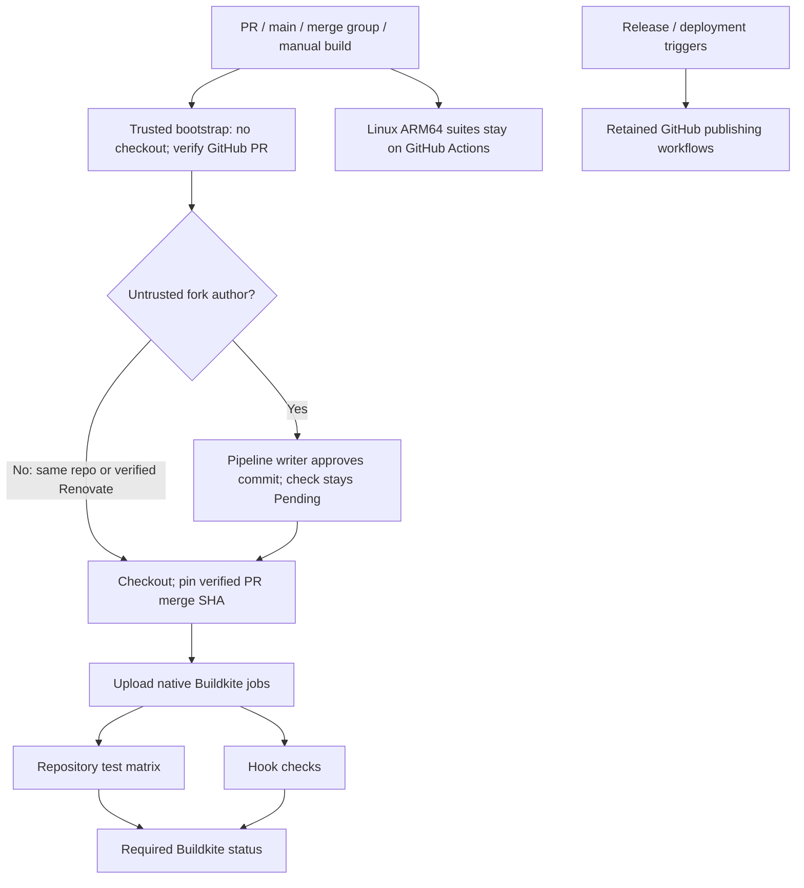
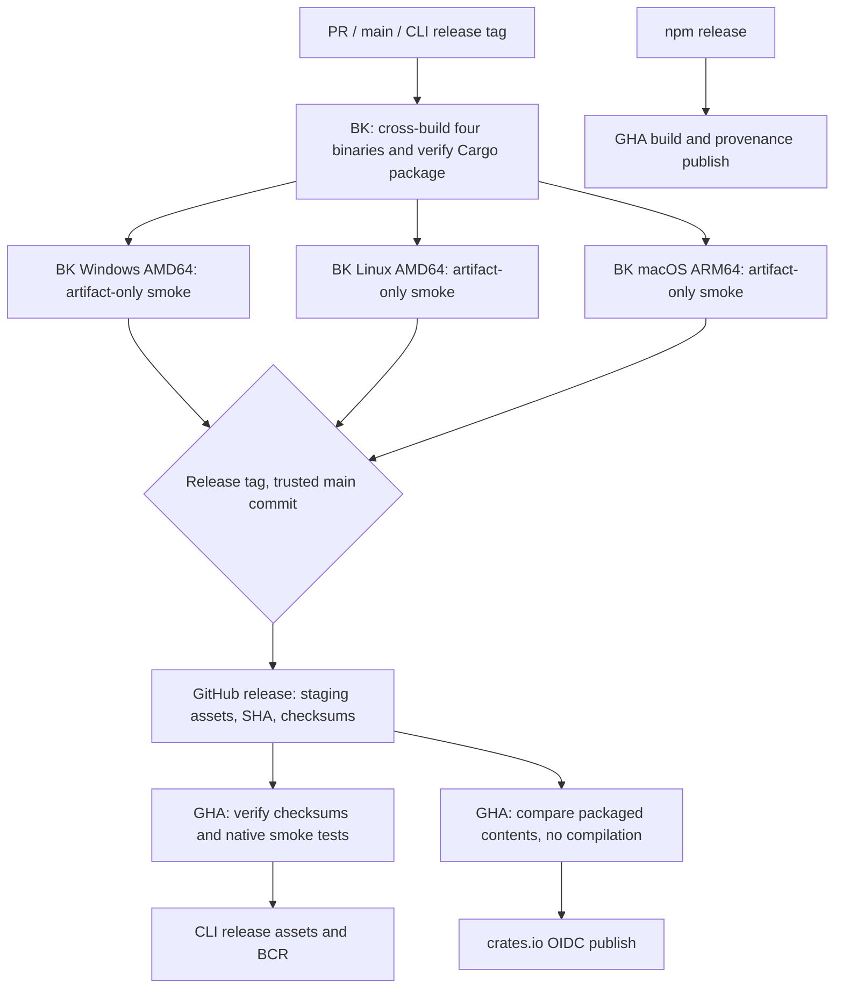

# Buildkite CI

Native Rust tests, non-PR functional tests, Linux AMD64 and macOS ARM64 BCR overlay validation; Lefthook pre-commit checks. BCR validation runs on every build instead of only matching paths.

Each Bazel job restores its suite/version/platform cache from `oss-ci-v2`, runs checks, then saves after success. Verified pipeline/branch claims isolate writes; main never restores PR caches. Cache only repository downloads and Bazel action outputs. No shared hosted volumes or cached executables. Fork branch prefixes must stay enabled. Hosted queues: `oss` (Linux AMD64), `oss_darwin_arm64` (macOS ARM64). Queue `default` is not used. Tools are checksum-pinned; pnpm follows `packageManager` or npm uses `npm ci`.

Paste `bootstrap.yml` into pipeline settings; never load approval policy from a PR checkout. Forks require writer approval before checkout or hooks. Only GitHub-verified `renovate[bot]` (ID `29139614`, type `Bot`) bypasses. Each new commit needs approval; API errors and stale PR heads fail closed. Enable third-party forks and publish blocked builds as Pending. Enable workflow-authorized GitHub tokens for release asset uploads. PR tokens remain read-only; merge queues cannot request tokens. Keep pipeline/cluster secrets disabled.

Build main pushes, PR updates/reopens/base changes, and merge groups; enable `codescythe_cli_v*` tags through the branch filter. Preserve PR exclusions shown in `pipeline.yml`. Manual builds support former workflow-dispatch checks. Retain required GHA ARM64 checks. Replace migrated required GHA checks with `buildkite/codescythe` from the Buildkite app only after native checks pass.

Remaining GHA: Release Please, CLI/npm/crates publishing, BCR publishing, GitHub Pages deployment.

Linux ARM64 jobs stay on GHA per requested runner policy. No new queue provisioned.

## Releases

Every build cross-compiles four CLI binaries and verifies `cargo package` once on BK. Dependent Linux AMD64, macOS ARM64, and Windows AMD64 smoke jobs download artifacts from that build’s `release-build` step, verify commit/build/pipeline identity and SHA-256, then run version/help, fixture analysis, and Linux static-link checks without compiling. Tag uploads wait for all three smoke jobs. BK uploads staging assets with a commit/checksum manifest using a short-lived GitHub App token. GHA waits for that manifest, checks the exact tag commit and every checksum, then smoke-tests Linux/macOS binaries before publishing their usual release asset names and BCR overlay. Linux ARM64 smoke tests stay on GHA.

Crates GHA compares every packaged file against the BK-verified `.crate`, then uses OIDC and `cargo publish --locked --no-verify`; packaging repeats, compilation does not. npm release builds and provenance stay on GHA. Manual GHA dry runs select a CLI release tag containing this workflow; they verify existing BK staging assets without publishing.

Pipeline settings: branch filter `main gh-readonly-queue/* codescythe_cli_v*`, GitHub tag builds enabled, workflow-authorized GitHub access tokens enabled. Upload requires a release tag whose commit is already on main; PR builds only produce test artifacts.

Windows smoke uses PowerShell on `oss_win_amd64`, pins the producer’s PR merge commit, verifies the complete release manifest and hashes, then runs version/help and fixture analysis. The Windows binary is uploaded with the other CLI assets.
